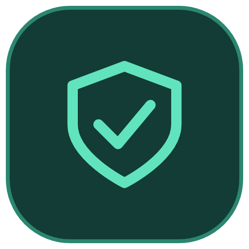
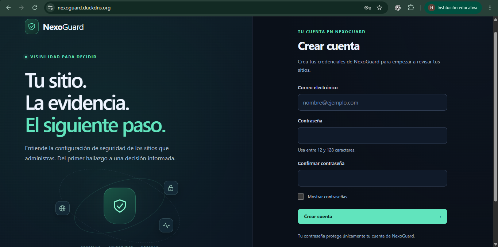

# NexoGuard — Frontend



NexoGuard es una aplicación universitaria de revisión de seguridad web para propietarios de sitios. Permite acreditar control de un dominio, consultar análisis de su página principal y entender evidencia y recomendaciones. Una comprobación aprobada no garantiza que un sitio carezca de vulnerabilidades.

- **Aplicación desplegada:** https://nexoguard.duckdns.org
- **Backend complementario:** https://github.com/IsaacEspinoza0406/nexoguard-backend

## Vista previa



Captura real del frontend; no representa resultados de análisis ni contiene datos de una cuenta.

## Funcionalidades implementadas

- Registro, login, acceso privado y logout mediante la API NestJS. Las credenciales pertenecen a NexoGuard, no a Google u otros servicios.
- Dashboard de sitios propios, registro de dominios y estado de propiedad.
- Verificación guiada: generar el desafío, descargar el archivo, publicarlo y comprobarlo. El código permanece en el panel; no se coloca en notificaciones ni almacenamiento persistente del navegador.
- Inicio de análisis manual, consulta de estado, resultados con evidencia y recomendaciones, historial y comparación entre análisis compatibles del mismo sitio y revisión de dominio.
- Configuración diaria o semanal por activación expresa del propietario; consulta y lectura de alertas dentro de la aplicación.
- Informes complementarios de SSL Labs con procedencia, fecha, estados y notas del proveedor, separados de las comprobaciones propias. Las solicitudes externas requieren consentimiento; leer un informe conservado no inicia otra evaluación.
- Interfaz oscura adaptable a móvil y escritorio, navegación por teclado, controles para mostrar contraseñas, estados de carga y feedback junto a las acciones. Notificaciones compartidas de progreso, éxito, información y error, con cierre accesible y respeto de movimiento reducido.

Las notificaciones de éxito esperan confirmación de la API. Los errores que necesitan intervención permanecen también junto al campo o acción; no se sustituyen por un aviso temporal. El frontend no inventa métricas ni trata `NO_EVALUADO` como aprobado.

## Stack y estructura

Next.js 16.4.6 con App Router, React 19, TypeScript y Tailwind CSS 4. Se utilizan estilos y componentes propios sin fuentes remotas ni servicios de analítica añadidos. Jest, Testing Library, ESLint y TypeScript proporcionan la validación automatizada.

```text
src/
  app/
    layout.tsx             Diseño raíz y proveedor de notificaciones
    globals.css            Sistema visual compartido
    page.tsx               Registro
    login/                 Inicio de sesión
    cuenta/                Dashboard, sitios, análisis y monitoreo
  components/              Identidad visual, acceso y notificaciones
  lib/                     API, credenciales/CSRF y política CSP
  proxy.ts                 CSP de producción y nonce por respuesta
docker/                    Gateway Nginx y plantillas
Dockerfile                 Imagen de Next.js
```

Las pruebas se mantienen junto a componentes y módulos. La API y las reglas de negocio pertenecen al backend; los botones deshabilitados no sustituyen la autorización del servidor.

## Requisitos y configuración local

Se requieren Node.js 24 y npm. Para el flujo completo se necesita el backend complementario en ejecución, con MySQL configurado y migraciones aplicadas de forma explícita. Docker con contenedores Linux es necesario únicamente si se construyen o ejecutan imágenes.

Desde este repositorio, en PowerShell:

```powershell
if (-not (Test-Path .env.local)) { Copy-Item .env.example .env.local }
npm ci
npm run dev
```

La [plantilla pública](./.env.example) contiene únicamente configuración de ejemplo. Edita el archivo privado creado según el entorno:

| Variable | Uso local | Alcance |
| --- | --- | --- |
| `NEXT_PUBLIC_API_URL` | `http://127.0.0.1:3001` | URL de la API que utiliza el navegador; queda incorporada durante el build. |
| `API_INTERNAL_URL` | `http://127.0.0.1:3001` | URL que utiliza únicamente el servidor Next.js para comprobar sesiones. |

Abre **http://127.0.0.1:3000**. El modo local del backend permite ese origen exacto: no intercambiarlo por `localhost`. Si Next.js se ejecuta dentro de Docker, la dirección interna puede ser `http://back:3001` cuando ese sea el nombre del servicio en la red compartida. El navegador no puede resolver ese nombre Docker.

No incluyas secretos en `NEXT_PUBLIC_`: sus valores son públicos. Este repositorio no necesita `DATABASE_URL`, contraseñas MySQL, claves CSRF del backend ni credenciales de SSL Labs. Los archivos `.env` reales y certificados privados no deben publicarse ni copiarse a la imagen.

Para compilar y ejecutar localmente en modo producción:

```powershell
npm run build
npm start
```

Las variables públicas deben estar definidas **antes de compilar**; cambiarlas solo al arrancar no actualiza el JavaScript enviado al navegador. El comando `start` escucha en la interfaz local por defecto. El área privada necesita un servidor Next.js activo: no se entrega como una exportación HTML estática.

## Rutas y flujo de uso

| Ruta | Pantalla |
| --- | --- |
| `/` | Registro de cuenta |
| `/login` | Inicio de sesión |
| `/cuenta` | Área privada: sitios, propiedad, resultados, historial, comparación, programación y alertas |

1. Crea una cuenta con correo y contraseña de 12 a 128 caracteres. La confirmación se valida solo en el frontend y no se envía a la API. Registrarse no inicia sesión automáticamente.
2. Inicia sesión y registra un dominio que administras, sin protocolo, puerto ni ruta.
3. Cuando puedas publicar, genera el desafío y descarga `nexoguard-verification.txt`. Colócalo en `/.well-known/nexoguard-verification.txt` del sitio y publica la versión. Debe responder por HTTPS válido sin redirecciones. Solo después solicita la comprobación.
4. El desafío caduca a los 30 minutos y la propiedad a los 30 días. Cada subdominio requiere su propia prueba; renovar invalida la anterior. Si se pierde el código al salir de la pantalla, debe generarse otro.
5. Con propiedad vigente, solicita un análisis manual, consulta sus resultados e historial y compara dos análisis de la misma revisión. La programación es opcional y requiere activación expresa. Guardarla no demuestra que ya haya ocurrido una ejecución automática.

Next.js valida la sesión con NestJS antes de renderizar `/cuenta`; la mera presencia de una cookie no concede acceso. El servidor sigue comprobando propiedad y autorización en cada operación.

## Comunicación y seguridad

El registro obtiene su token mediante `GET /users/registration-token`. Login y operaciones autenticadas utilizan `GET /auth/csrf`. Las mutaciones envían cookies con `credentials: 'include'`, origen permitido y `X-CSRF-Token`; tras login se obtiene un token ligado a la sesión actual. Contraseñas, cookies y tokens no se guardan en `localStorage` ni se muestran en toasts.

En producción se conservan cookies Secure, HttpOnly y SameSite Strict, HTTPS y CSP con nonce por respuesta. Los datos del usuario y del proveedor se renderizan como contenido, sin insertar su HTML. Una sesión caducada exige volver a iniciar sesión; los controles visuales no omiten las validaciones del backend.

## Comandos de validación

Estos scripts existen en [package.json](./package.json):

```powershell
npm run lint
npm run typecheck
npm run test
npm run build
```

Las pruebas de componentes usan respuestas simuladas de la API: comprueban interfaz y comportamiento, no persistencia MySQL, propiedad pública ni un análisis externo real. La última validación del frontend para la publicación aprobó 87 pruebas, lint, tipos y build; esta edición del README no vuelve a ejecutarlos.

## Docker y despliegue actual en EC2

El [Dockerfile](./Dockerfile) acepta `NEXT_PUBLIC_API_URL` como argumento público de compilación. Para crear la imagen destinada a un proxy de mismo origen:

```powershell
docker build --platform linux/amd64 --build-arg NEXT_PUBLIC_API_URL=/api -t nexoguard-front:local .
```

Esta imagen necesita un proxy que dirija `/api/` al backend; el argumento no crea el proxy. Para ejecutar el navegador directamente contra la API local, compila con su URL pública local en lugar de `/api`. `API_INTERNAL_URL` se configura al arrancar el contenedor para SSR y debe ser accesible desde la red de Next.js.

La aplicación real está publicada en **https://nexoguard.duckdns.org**, sobre AWS EC2 Ubuntu 24.04 LTS x86_64 con Docker Compose. Nginx termina HTTPS con certificado renovable y redirección desde HTTP, sirve el frontend en `/` y la API en `/api/`. La imagen pública utiliza `NEXT_PUBLIC_API_URL=/api`; la versión anterior publicada utilizaba `API_INTERNAL_URL=http://back:3001`; la actualización preparada exige `https://back:3001` con CA validada. Esta actualización no se ha desplegado todavía. Next.js, NestJS y MySQL no publican sus puertos directamente a Internet.

El gateway de EC2 se construye con [docker/Dockerfile.ec2-gateway](./docker/Dockerfile.ec2-gateway) y sus [plantillas](./docker/ec2/). La orquestación completa y la configuración privada se administran separadamente, fuera de los repositorios de aplicación; construir esta imagen no despliega toda la plataforma. Los cambios de frontend se publican conservando una imagen anterior para reversión, sin necesidad de reiniciar MySQL.

## TLS interno de la versión preparada

El [arranque HTTPS](./server.mjs) utiliza el manejador de Next sin cambiar rutas, autenticación, SSR ni CSP. Es un servidor HTTPS mínimo porque `next start` no expone HTTPS de producción. La imagen Docker lo utiliza por defecto; `npm run dev` y `npm start` conservan el desarrollo local HTTP. Para este último configura `NEXOGUARD_HTTP_MODE=local` explícitamente; no trasladar ese modo a producción.

Producción requiere `NEXOGUARD_INTERNAL_TLS_CERT` y `NEXOGUARD_INTERNAL_TLS_KEY` montados privadamente, `NODE_EXTRA_CA_CERTS` con la CA web y `API_INTERNAL_URL=https://back:3001`. No son variables `NEXT_PUBLIC_`. El certificado del frontend debe incluir SAN `front` y el backend SAN `back`. El proceso falla si falta la configuración; no usa opciones para ignorar certificados.

La [plantilla Nginx](./docker/ec2/tls.conf.template) mantiene HTTPS público, redirección, ACME y archivo Google. Los upstreams son HTTPS con `proxy_ssl_verify on`, CA y nombres/SNI fijos `front`/`back`. El [entrypoint](./docker/ec2/entrypoint.sh) comprueba montajes y ejecuta `nginx -t`. La [imagen gateway](./docker/Dockerfile.ec2-gateway) no incluye certificados privados. Su modo bootstrap responde 503 para la aplicación; no sirve login por HTTP.

| Tramo | Configuración preparada |
| --- | --- |
| Navegador → Nginx | Certificado público y redirección HTTP → HTTPS |
| Nginx → Next.js / NestJS | HTTPS con CA y nombre de servicio validados |
| SSR → NestJS | HTTPS y CA adicional de Node cargada al inicio |
| NestJS → MySQL / transporte | TLS existente, preservado sin rotar su CA |

**La topología nueva está preparada para validación/despliegue manual; no está aplicada en EC2.** El HTTPS público de la versión anterior no acreditaba cifrado de estos saltos internos. El [procedimiento del backend](https://github.com/IsaacEspinoza0406/nexoguard-backend/blob/main/docker/ec2/INTERNAL_TLS.md) incluye montajes, generación, respaldo y reversión. La activación inicial actualiza cuatro servicios (incluye el transporte con dependencias corregidas); las renovaciones de hojas de 90 días recrean solo backend/frontend/gateway. Su timer systemd está preparado y validado localmente, todavía no instalado en EC2. No hay migraciones. El HTTP de desarrollo local, ACME/salud y la comprobación anónima de redirección siguen identificados por su finalidad.

## Ejemplos prácticos de corrección

El detalle de resultados y la comparación presentan las doce guías `practical-v1` suministradas por el backend. El [componente compartido](./src/app/cuenta/practical-guide.tsx) permite elegir tecnología, consultar ubicación, antes ilustrativo, configuración o procedimiento, aplicación y comprobación. Copia únicamente el bloque corregido y confirma después de que el portapapeles acepte la operación; si falla, mantiene una alternativa manual visible. No almacena tokens ni contraseñas.

Las guías no identifican la tecnología de un sitio por inferencia. Los resultados no aplicables/no evaluados se explican antes de modificar nada; un resultado aprobado no exige cambios por el ejemplo. HSTS usa 300 segundos de laboratorio sin subdominios/preload implícitos; cookies usa NestJS/Express y una cookie ficticia; CSP es contextual, no una receta universal. Los catálogos orientativos no cambian evidencia ni resultados históricos.

## Límites y pendientes

- El motor observa la página principal de sitios propios verificados; no realiza una auditoría integral ni pruebas ofensivas. No ofrece garantías de seguridad absoluta.
- Los resultados distinguen hallazgos, aprobados, no aplicables y no evaluados. Una CSP presente queda `NO_EVALUADO`; no se inventan puntuaciones globales ni mejoras a partir de errores de conexión.
- SSL Labs es complementario y depende del proveedor y de configuración privada del backend. Su nota no equivale a una aprobación del motor propio. Un fallo de actualización se distingue del informe conservado.
- Las alertas solo se muestran dentro de la aplicación; no son correos ni vigilancia continua. La ejecución programada requiere el backend activo y propiedad vigente.
- No se presentan recuperación de contraseña por interfaz, administración de roles o certificación WCAG como funciones completadas. La accesibilidad es un objetivo de diseño, no una certificación.
- Quedan avisos moderados en herramientas de desarrollo de la cadena ESLint/TypeScript; el despliegue y las pruebas realizadas no sustituyen mantenimiento ni una auditoría completa.
- **La alerta de Google Safe Browsing continúa pendiente.** Se envió un reporte de posible clasificación incorrecta, sin resolución confirmada. HTTPS y el rediseño no la resuelven; no se recomienda ignorar advertencias ni desactivar protecciones.

## Licencia

El código original de NexoGuard se distribuye bajo [Apache License 2.0](./LICENSE).
Copyright 2026 Héctor Isaac Espinoza Mendoza. Consulte también [NOTICE](./NOTICE).
Las dependencias y los componentes de terceros conservan sus respectivos avisos y licencias.
